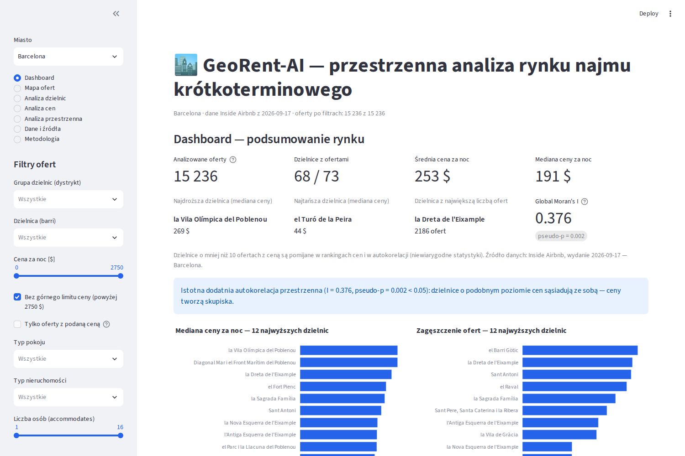
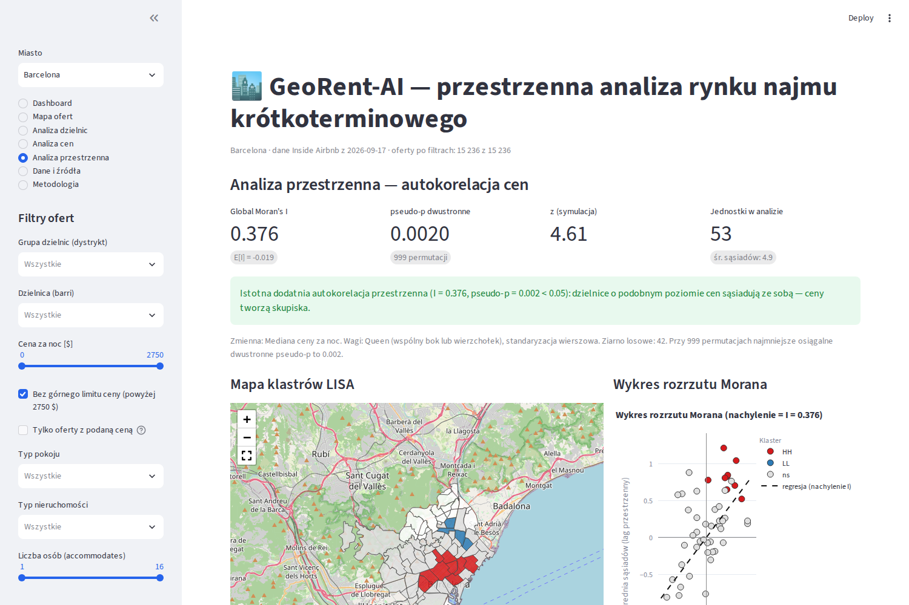
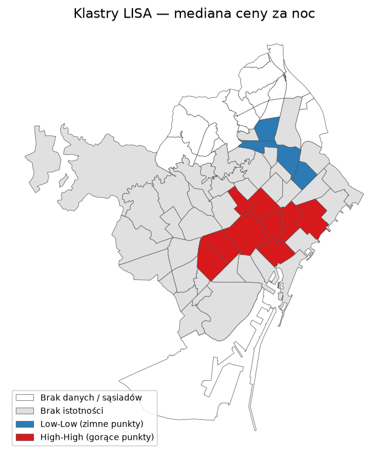
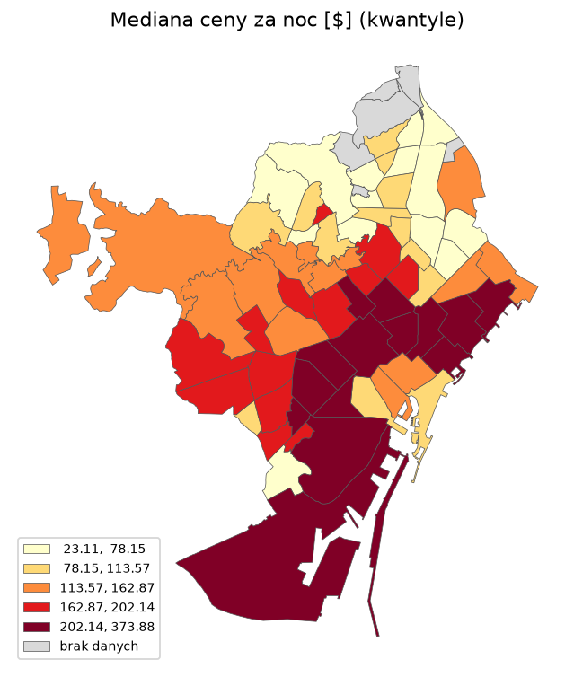

# GeoRent-AI — przestrzenna analiza rynku najmu krótkoterminowego

> **Projekt zaliczeniowy z przedmiotu Analiza Danych Przestrzennych**\
> **Autor:** Dominik Ciura\
> **Stan:** wersja końcowa (v1.0) — aplikacja, analizy, eksport QGIS, testy i Docker zweryfikowane\
> **Repozytorium:** <https://github.com/d0ming3ss/ADP>

Dokument opisuje rzeczywisty stan rozwiązania. Szczegółowy przewodnik po modułach, danych i narzędziach: `docs/INSTRUKCJA.md`. Wszystkie wartości liczbowe w sekcji 7 pochodzą z obliczeń na pobranych danych
(plik `docs/WYNIKI.md` jest generowany skryptem `scripts/generate_results.py` — nie jest edytowany ręcznie).

---

## 1. Opis problemu i cel

Rynek najmu krótkoterminowego (Airbnb) jest silnie zróżnicowany przestrzennie: ceny i koncentracja ofert zależą od lokalizacji.
Projekt odpowiada na pytania:

* jak rozmieszczone są oferty i gdzie jest ich największe zagęszczenie?
* które dzielnice są najdroższe, a które najtańsze?
* jak lokalizacja wpływa na cenę oferty?
* czy wysokie i niskie ceny tworzą **skupiska przestrzenne** (autokorelacja przestrzenna, Moran's I, LISA)?

Wynikiem jest aplikacja webowa (Streamlit) oparta na rzeczywistych danych Inside Airbnb, z operacjami GIS (Spatial Join, agregacje,
kartogramy), statystyką przestrzenną (PySAL) i eksportem warstw do QGIS.

**Obszar analizy: Barcelona** — wydanie danych **2026-09-17**. Uzasadnienie wyboru: komplet plików (oferty, granice), ok. 15 tys. ofert,
73 dzielnice po scaleniu (liczba wystarczająca dla analizy autokorelacji — Paryż ma tylko 20 jednostek), poprawny układ WGS 84.
Miasto zmienia się zmienną `GEORENT_CITY` lub parametrem `--city` (obsługiwane: Barcelona, Lizbona, Amsterdam, Berlin, Praga, Wiedeń;
sprawdzono tylko Barcelonę).

## 2. Zakres funkcjonalny (zrealizowany i zweryfikowany)

| Obszar | Realizacja |
|---|---|
| Pozyskiwanie danych | pobieranie `listings.csv.gz`, `neighbourhoods.geojson`, `neighbourhoods.csv`; automatyczne wykrywanie najnowszego wydania z indeksu Inside Airbnb; cache lokalny; walidacja; aktualizacja (`update`, `--force`); metadane (źródło, wydanie, data pobrania, SHA-256, licencja) |
| Czyszczenie | duplikaty, konwersja cen (symbole walut, separatory), współrzędne (zakres, 0/0, obwiednia miasta), naprawa geometrii, oznaczanie ofert odstających (Tukey na ln ceny), raport jakości |
| GIS | warstwa punktowa (EPSG:4326), warstwa poligonowa, `dissolve` dzielnic o powtórzonej nazwie, Spatial Join (`within`), powierzchnie w UTM, zagęszczenie, odległość od centrum |
| Statystyki dzielnic | liczba ofert, średnia, mediana, min, max, odchylenie standardowe, kwartyle, zagęszczenie, cena za osobę, udział całych mieszkań, ocena, szac. obłożenie |
| Kartogramy | dynamiczne mapy choropletyczne (klasy kwantylowe, legenda z jednostką), 8 miar |
| Autokorelacja | Global Moran's I (test permutacyjny), Local Moran's I (LISA) z klastrami HH/LL/HL/LH, wykres rozrzutu Morana, macierze wag Queen / Rook / KNN, korekta FDR, porównanie wariantów i wpływu odstających |
| Aplikacja | 7 sekcji, filtry wpływające na wszystkie wyniki (w tym na Moran's I), eksport z poziomu UI, przycisk aktualizacji danych |
| QGIS | GeoPackage (4 warstwy), GeoJSON, CSV, gotowy projekt `.qgz` ze stylami |
| Jakość | 103 testy (jednostkowe + integracyjne), Docker, docker-compose |

Prototyp z etapu 1 (OpenSky Network, ruch lotniczy nad Europą) został zachowany w `poc/opensky_app.py`
(`streamlit run poc/opensky_app.py`); nie jest częścią analizy Airbnb.

## 3. Architektura

```text
Inside Airbnb (CSV.GZ + GeoJSON)
        │  georent/data_source.py   pobieranie, walidacja, metadane (data/raw/<miasto>/<wydanie>/)
        ▼
georent/cleaning.py        czyszczenie, ceny, współrzędne, oznaczanie odstających
        ▼
georent/spatial.py         punkty, poligony, Spatial Join, agregacje dzielnic, powierzchnie
        ▼
georent/autocorr.py        wagi (libpysal), Global Moran's I, LISA (esda)
        ▼
georent/analysis.py        filtry, pipeline end-to-end, wpływ lokalizacji, wpływ odstających
        ├──────────────► georent/export.py → GPKG/GeoJSON/CSV → georent/qgis_project.py → .qgz
        ├──────────────► georent/visualization.py (Folium, Plotly) → georent/ui.py (Streamlit) → app.py
        └──────────────► georent/cli.py   (python -m georent download|update|analyze|export)
```

Konfiguracja: `georent/config.py` (zmienne środowiskowe `GEORENT_*`, katalog miast). Logika jest rozdzielona od interfejsu —
`ui.py` zawiera wyłącznie obsługę Streamlit i buforowanie.

## 4. Wymagania techniczne

* Python 3.12+ (testowano na 3.14 lokalnie i 3.12 w Dockerze); zależności z przypiętymi wersjami w `requirements.txt`
  (streamlit, geopandas, shapely, pyogrio, libpysal, esda, mapclassify, folium, plotly, pandas, numpy, scipy, requests);
* Docker + Docker Compose (opcjonalnie);
* QGIS ≥ 3.28 (opcjonalnie; do otwarcia wyników; projekt `.qgz` generowany i sprawdzony w QGIS 3.34);
* dostęp do Internetu przy pierwszym pobraniu danych (ok. 8 MB) i dla kafelków OpenStreetMap.

## 5. Instalacja i uruchomienie

### 5.1. Lokalnie

```bash
git clone https://github.com/d0ming3ss/ADP.git && cd ADP
python3 -m venv .venv && source .venv/bin/activate
pip install -r requirements-dev.txt          # zależności + pytest
python -m georent download                    # pobranie danych (domyślnie Barcelona)
streamlit run app.py                          # http://localhost:8501
```

Jeżeli dane nie zostały pobrane, aplikacja wyświetla przycisk „Pobierz dane”.

### 5.2. Docker

```bash
docker compose up --build                     # http://localhost:8501 ; dane w ./data, eksport w ./exports
# albo bez compose:
docker build -t georent-ai .
docker run --rm -p 8501:8501 -v "$PWD/data:/app/data" -v "$PWD/exports:/app/exports" georent-ai
```

Wolumeny zachowują pobrane dane po restarcie kontenera. Obraz działa jako użytkownik `uid 1000` (zgodny z typowym
użytkownikiem Linuksa, dzięki czemu wolumeny są zapisywalne). Inne miasto / port: `GEORENT_CITY=lisbon GEORENT_PORT=8600 docker compose up`.
Polecenia CLI w kontenerze: `docker compose run --rm georent python -m georent download`.

### 5.3. Polecenia CLI

| Polecenie | Działanie |
|---|---|
| `python -m georent download [--city X] [--release RRRR-MM-DD] [--force]` | pobranie danych (bez `--force` użyje kopii lokalnej) |
| `python -m georent update` | sprawdzenie indeksu Inside Airbnb i pobranie nowszego wydania |
| `python -m georent analyze [--weights queen\|rook\|knn] [--variable median_price] [--exclude-outliers]` | analiza i wypisanie wyników w terminalu |
| `python -m georent export` | eksport warstw GIS + projekt QGIS (`exports/<miasto>/`) |
| `python scripts/generate_results.py` | regeneracja `docs/WYNIKI.md` i rysunków `docs/img/*.png` |
| `python -m pytest` | testy |

Parametry (zmienne środowiskowe): `GEORENT_CITY`, `GEORENT_DATA_DIR`, `GEORENT_EXPORT_DIR`, `GEORENT_PERMUTATIONS` (999),
`GEORENT_SEED` (42), `GEORENT_MIN_LISTINGS` (10), `GEORENT_HTTP_TIMEOUT` (60 s).

## 6. Instrukcja obsługi aplikacji

Panel boczny: wybór miasta (spośród pobranych), wybór sekcji, **filtry ofert** oraz parametry analizy przestrzennej.
Filtry: grupa dzielnic i dzielnica, zakres cen (z opcją „bez górnego limitu”), typ pokoju, typ nieruchomości, liczba osób,
oferty z dostępnymi terminami, minimalna dostępność w roku, minimalna liczba opinii, tylko oferty z ceną, wykluczenie
cen odstających. Zmiana filtra przelicza statystyki dzielnic **i** autokorelację przestrzenną. Gdy po filtrach zostaje zbyt
mało dzielnic (< 8) na wiarygodny test, aplikacja wyświetla komunikat zamiast wyniku.

| Sekcja | Zawartość |
|---|---|
| Dashboard | KPI: liczba ofert, dzielnice, średnia i mediana ceny, najdroższa/najtańsza dzielnica, dzielnica z największą liczbą ofert, Global Moran's I; rankingi |
| Mapa ofert | punkty (kolor = cena, popup), klastry, heatmapa; granice dzielnic; pełny ekran |
| Analiza dzielnic | dwa kartogramy obok siebie (8 miar do wyboru), tabela statystyk z eksportem CSV |
| Analiza cen | histogram, boxploty (typ pokoju, dystrykt, liczba gości), cena vs odległość od centrum, wpływ lokalizacji (OLS, Spearman) |
| Analiza przestrzenna | Moran's I + test permutacyjny + interpretacja, mapa LISA, wykres rozrzutu Morana, tabela klastrów, dzielnice wyłączone, odporność (wagi, odstające) |
| Dane i źródła | źródło, wydanie, data pobrania, licencja, hasze plików, raport czyszczenia, aktualizacja danych, **eksport do QGIS** |
| Metodologia | opis metod i ograniczeń (`docs/METODOLOGIA.md`) |

Zrzuty ekranu: `docs/img/ekran_01_dashboard.png` … `ekran_07_metodologia.png`.




## 7. Wyniki (Barcelona, wydanie 2026-09-17, bez filtrów)

Wszystkie liczby poniżej pochodzą z obliczeń (`docs/WYNIKI.md`); parametry: 999 permutacji, ziarno 42, próg 10 ofert z ceną.

**Dane.** 15 236 ofert w pliku; 12 610 (82,8%) ma cenę; 2 626 bez ceny (pole puste). Brak duplikatów, brak niepoprawnych
współrzędnych. Oznaczono 188 ofert o cenach odstających (poza przedziałem 17,6–1 506 $). Plik GeoJSON zawiera 75 obiektów,
po scaleniu powtórzonych nazw (Vallvidrera występuje jako 3 poligony) — 73 dzielnice. Spatial Join zgodny z etykietą źródłową
`neighbourhood_cleansed` w **100,00%** ofert, żadna oferta nie leży poza granicami.

**Rozkład cen.** Średnia 253,41 $, mediana 190,67 $, odchylenie standardowe 386,34 $, zakres 12,81–11 245,03 $ (rozkład silnie
prawoskośny — mediana jest właściwszą miarą). 68 dzielnic ma oferty, 53 spełniają próg wiarygodności (≥ 10 ofert z ceną).

**Dzielnice.** Najdroższe wg mediany: la Vila Olímpica del Poblenou (269,0 $), Diagonal Mar i el Front Marítim del Poblenou
(268,9 $), la Dreta de l'Eixample (252,5 $). Najtańsze: el Turó de la Peira (43,9 $), la Font d'en Fargues (59,8 $),
Sant Martí de Provençals (60,0 $). Najwięcej ofert: la Dreta de l'Eixample (2 186); największe zagęszczenie: el Barri Gòtic
(1 080 ofert/km²), przed la Dreta de l'Eixample (1 029) i Sant Antoni (1 018). Dzielnice o największej liczbie ofert
i o największym zagęszczeniu to nie te same jednostki — dlatego prezentowane są obie miary.

**Global Moran's I (mediana ceny, Queen, n = 53 dzielnice):** **I = 0,376** (E[I] = −0,019), z = 4,61, pseudo-p dwustronne
= 0,002 (minimum osiągalne przy 999 permutacjach). **Istotna dodatnia autokorelacja przestrzenna** — dzielnice o podobnych
cenach sąsiadują ze sobą. Wynik jest odporny na wybór wag (Rook: I = 0,376; KNN k = 5: I = 0,394) oraz na ofert odstające
(bez nich I = 0,370, nadal p = 0,002). Dla zagęszczenia ofert I = 0,604 (silniejsza autokorelacja niż dla cen).

**LISA (dwustronne pseudo-p < 0,05):** 9 dzielnic High-High (Eixample, Sagrada Família, Fort Pienc, Sant Antoni, Poblenou i in.),
4 Low-Low (Vilapicina i la Torre Llobeta, la Sagrera, Porta, Sant Martí de Provençals), brak klastrów High-Low i Low-High,
40 nieistotnych, 20 dzielnic poza analizą (mała liczba ofert lub brak sąsiadów). **Uwaga:** po korekcie na wielokrotne testowanie
(FDR, α = 0,05) **żaden** klaster lokalny nie pozostaje istotny, więc klastry należy traktować jako eksploracyjne — silny jest
natomiast wynik globalny.

**Wpływ lokalizacji na cenę.** Cechy oferty (liczba gości, typ pokoju) tłumaczą 50,9% zmienności ln(ceny) (skorygowane R²);
sama dzielnica 9,7%; dzielnica dodaje do cech oferty 3,4 p.p. (R² = 0,543). Korelacja rang ceny z odległością od centrum jest
słaba (ρ = −0,134). Wniosek: lokalizacja ma mierzalny, ale mniejszy wpływ na cenę pojedynczej oferty niż jej cechy; efekt
jest wyraźny na poziomie dzielnic (autokorelacja), słabszy na poziomie ofert.




## 8. Dane: pozyskanie i przygotowanie

Szczegóły — `docs/METODOLOGIA.md`. W skrócie: pobierane są trzy pliki (`listings.csv.gz`, `neighbourhoods.geojson`,
`neighbourhoods.csv`) z `https://data.insideairbnb.com/…`; `calendar.csv` i `reviews.csv` świadomie pominięto (nie są potrzebne
do pytań projektu, a są bardzo duże). Dane zapisywane są w `data/raw/<miasto>/<wydanie>/` razem z `metadata.json`; pobieranie
odbywa się do katalogu tymczasowego i jest atomowo przenoszone po walidacji. Licencja danych: CC BY 4.0 (Inside Airbnb).

## 9. Eksport do QGIS

```bash
python -m georent export            # → exports/barcelona/{georent.gpkg, georent.qgz, geojson/, *.csv}
```

Otwarcie: QGIS → *Projekt → Otwórz* → `exports/barcelona/georent.qgz`. Pełna instrukcja, opis warstw i pól oraz interpretacja
klastrów: **`docs/QGIS.md`**. W Dockerze nie ma QGIS — kontener generuje GPKG/GeoJSON/CSV, a `.qgz` należy zbudować poleceniem
`python3 -m georent.qgis_project exports/<miasto>` na maszynie z QGIS (albo otworzyć sam `georent.gpkg`).

## 10. Testy

```bash
python -m pytest                    # lokalnie
docker compose run --rm georent python -m pytest   # w kontenerze
```

103 testy (lokalnie: 103 zaliczone; w Dockerze: 102 zaliczone, 1 pominięty — test projektu QGIS wymaga PyQGIS). Pokrycie: pobieranie
(atrapa sieci: sukces, cache, `--force`, 404, 5xx, timeout, brak połączenia, uszkodzony gzip, brak kolumn, niepoprawny GeoJSON,
puste dane), czyszczenie i konwersja cen (formaty walut, braki, ceny ≤ 0, duplikaty, współrzędne, pusty zbiór), Spatial Join
(punkt poza granicami, punkt na granicy, brak CRS, reprojekcja, geometrie niepoprawne, dzielnice o powtórzonej nazwie),
agregacje (dokładne wartości, dzielnice bez ofert, oferty bez ceny), Global/Local Moran (zgodność z wzorem liczonym ręcznie,
dodatnia/ujemna/brak autokorelacji, klastry HH/LL, wyspy, dzielnice bez sąsiadów, za mało jednostek, zmienna stała,
powtarzalność z ziarnem, wszystkie metody wag), filtry, eksport (warstwy, CRS, pola, GeoJSON, CSV), CLI, projekt QGIS,
oraz test integracyjny na rzeczywistych danych Barcelony.

## 11. Struktura repozytorium

```text
.
├── app.py                    # punkt wejścia Streamlit
├── georent/                  # pakiet: config, data_source, cleaning, spatial, autocorr, analysis,
│                             #   visualization, export, qgis_project, ui, cli
├── tests/                    # testy pytest
├── scripts/generate_results.py   # generuje docs/WYNIKI.md i rysunki
├── docs/                     # METODOLOGIA.md, QGIS.md, WYNIKI.md, img/ (zrzuty ekranu i mapy)
├── poc/opensky_app.py        # prototyp z etapu 1 (OpenSky)
├── data/                     # pobrane dane (poza Git; tworzony automatycznie)
├── exports/                  # wyniki eksportu GIS (poza Git)
├── Dockerfile, docker-compose.yml, .dockerignore
├── requirements.txt, requirements-dev.txt, pytest.ini, .streamlit/config.toml
├── README.md                 # skrócona instrukcja
└── PROJEKT.md                # ten dokument
```

## 12. Ograniczenia

* Dane są migawką z jednego dnia i zawierają ceny wywoławcze; 17% ofert nie ma ceny.
* Wyniki zależą od podziału na dzielnice (MAUP) i od macierzy wag; sprawdzono trzy warianty (wyniki spójne).
* 20 z 73 dzielnic (głównie peryferyjnych, o małej liczbie ofert) nie bierze udziału w analizie autokorelacji.
* Lokalne klastry LISA nie przechodzą korekty na wielokrotne testowanie (FDR) — wynik eksploracyjny.
* Graf sąsiedztwa Queen zawiera kilka rozłącznych składowych (biblioteka sygnalizuje to ostrzeżeniem).
* Pełny eksport QGIS (`.qgz`) wymaga lokalnej instalacji QGIS; w Dockerze dostępny jest eksport do GPKG/GeoJSON/CSV.
* Przetestowano wyłącznie Barcelonę; pozostałe miasta z katalogu (`config.py`) korzystają z tego samego kodu, ale nie były uruchamiane.
* Nie zaimplementowano modelu uczenia maszynowego (poza zakresem; w pierwotnym planie opcjonalny).
* Brak automatycznych testów interfejsu w przeglądarce; sekcje aplikacji sprawdzono testami `streamlit.testing` (brak wyjątków) oraz ręcznie w przeglądarce (zrzuty w `docs/img`).

## 13. Źródła

1. Inside Airbnb — <https://insideairbnb.com/get-the-data/> (CC BY 4.0).
2. Anselin L. (1995), *Local Indicators of Spatial Association — LISA*, Geographical Analysis 27(2).
3. Moran P.A.P. (1950), *Notes on continuous stochastic phenomena*, Biometrika 37.
4. Rey S., Anselin L. i in. — PySAL: <https://pysal.org/> (`libpysal`, `esda`).
5. GeoPandas — <https://geopandas.org/>; Shapely — <https://shapely.readthedocs.io/>; Streamlit — <https://docs.streamlit.io/>;
   Folium — <https://python-visualization.github.io/folium/>; Plotly — <https://plotly.com/python/>; QGIS — <https://qgis.org/>.
6. Benjamini Y., Hochberg Y. (1995), *Controlling the false discovery rate*, J. R. Stat. Soc. B 57.
