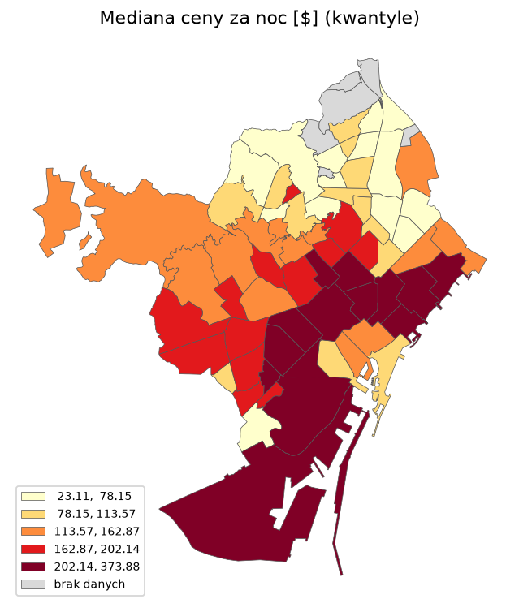
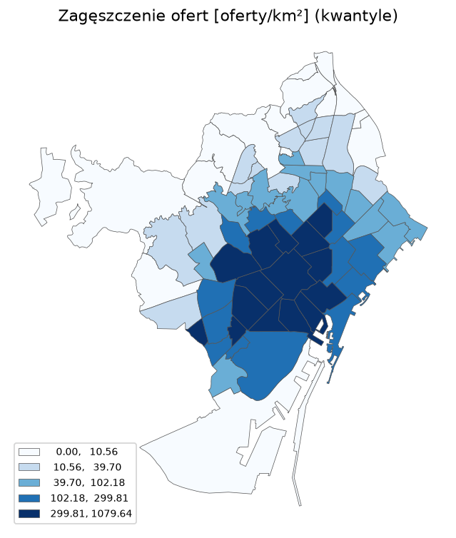
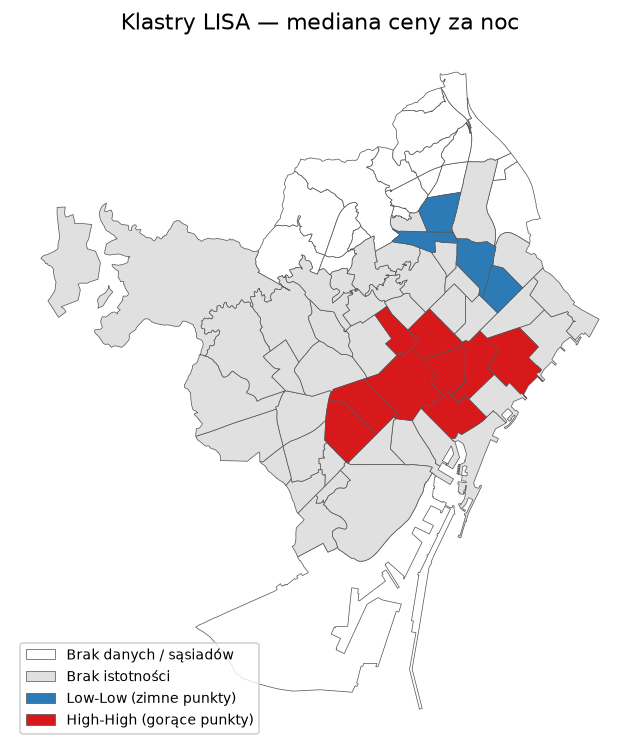
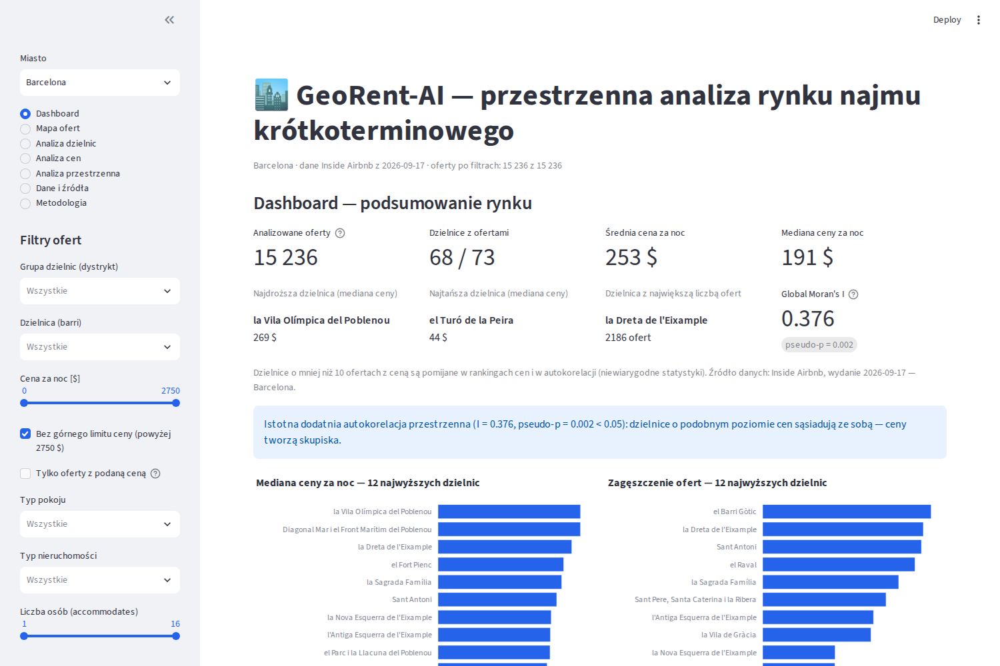
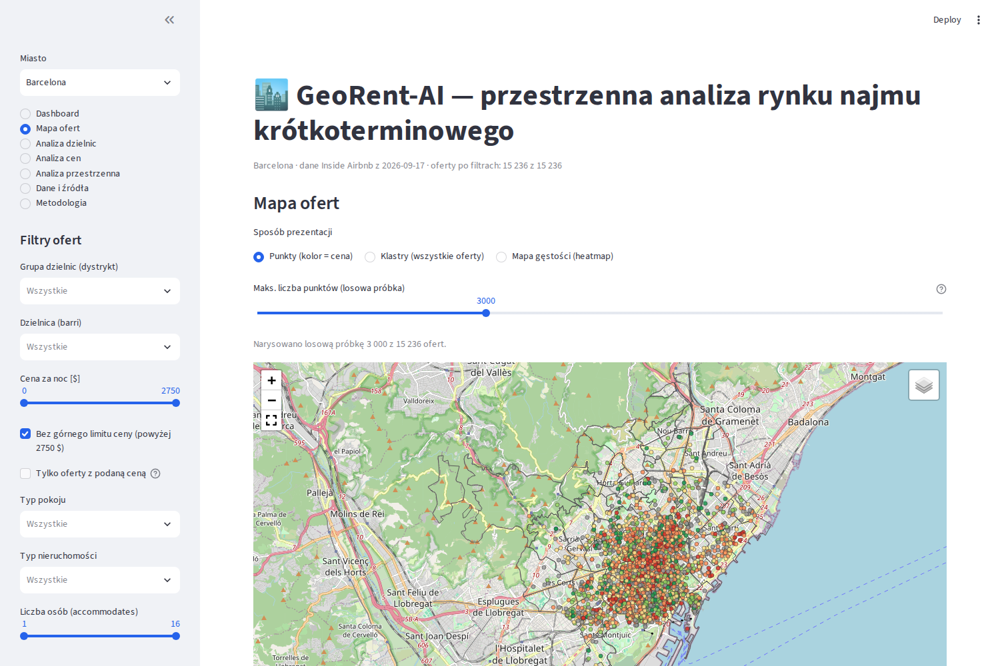
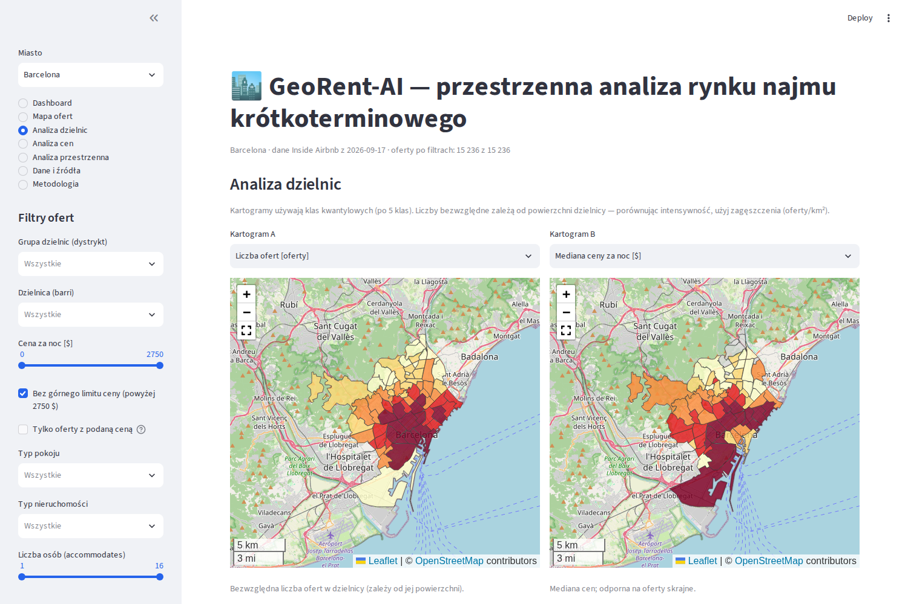
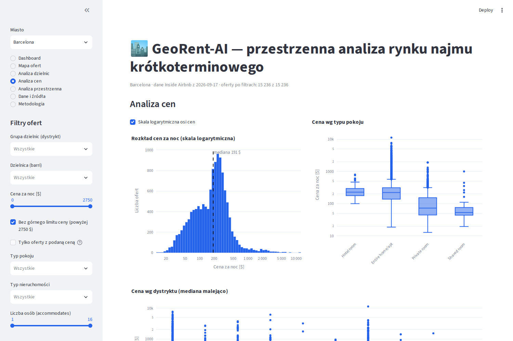
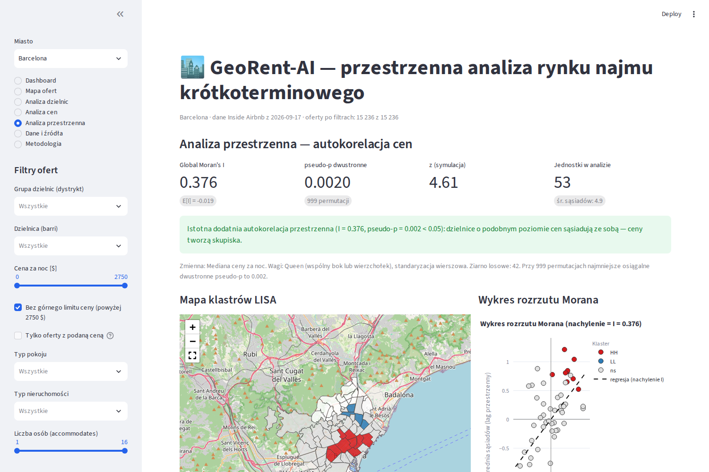
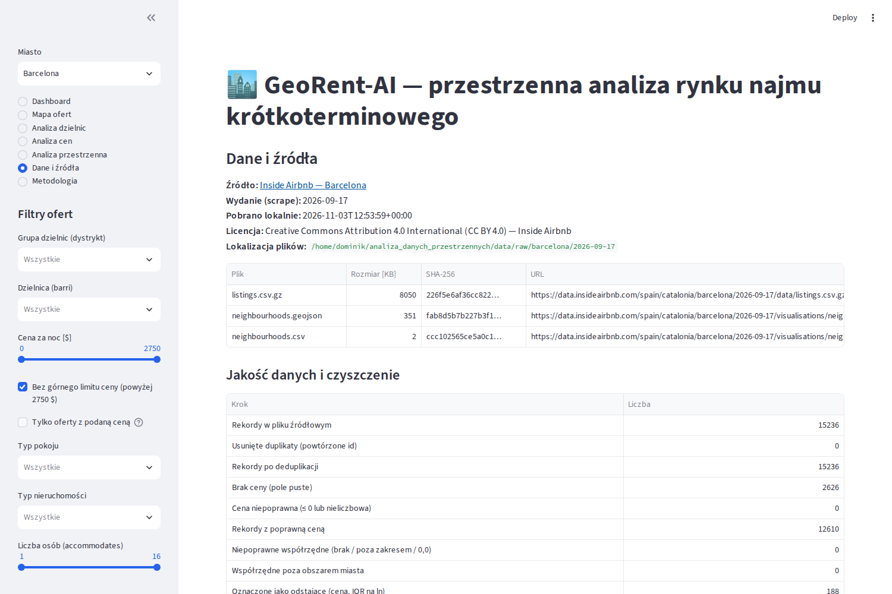
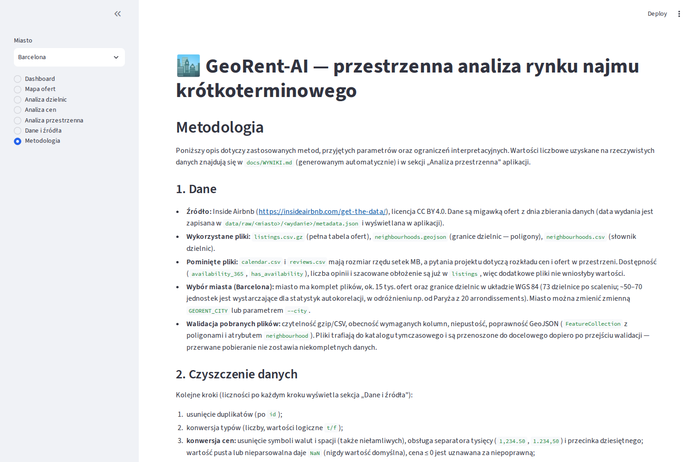

# GeoRent-AI — przestrzenna analiza rynku najmu krótkoterminowego

**Dokumentacja projektu i sprawozdanie z wykonania zadania**

| | |
|---|---|
| Przedmiot | Analiza Danych Przestrzennych |
| Autor | Dominik Ciura |
| Repozytorium | <https://github.com/d0ming3ss/ADP> |
| Wersja | 1.0 |
| Data weryfikacji | 2026-11-14 |
| Dane | Inside Airbnb, Barcelona, wydanie 2026-09-17 (CC BY 4.0) |

> Dokument jest jednocześnie dokumentacją techniczną i sprawozdaniem. Wszystkie liczby w rozdziale 7 pochodzą z obliczeń na
> pobranych danych — pełny, generowany automatycznie raport to [WYNIKI.md](WYNIKI.md) (skrypt `scripts/generate_results.py`).
> Rozdział 10 opisuje, co i jak zostało zweryfikowane.

## Spis treści

1. [Cel i pytania badawcze](#1-cel-i-pytania-badawcze)
2. [Zakres zrealizowanych prac](#2-zakres-zrealizowanych-prac)
3. [Integracje z usługami zewnętrznymi](#3-integracje-z-usługami-zewnętrznymi)
4. [Architektura](#4-architektura)
5. [Opis kodu — moduł po module](#5-opis-kodu--moduł-po-module)
6. [Metodologia (skrót)](#6-metodologia-skrót)
7. [Wyniki](#7-wyniki)
8. [Aplikacja Streamlit](#8-aplikacja-streamlit)
9. [Eksport do QGIS](#9-eksport-do-qgis)
10. [Testy i weryfikacja](#10-testy-i-weryfikacja)
11. [Instalacja i uruchomienie](#11-instalacja-i-uruchomienie)
12. [Struktura repozytorium i historia projektu](#12-struktura-repozytorium-i-historia-projektu)
13. [Ograniczenia](#13-ograniczenia)
14. [Bibliografia i źródła](#14-bibliografia-i-źródła)

---

## 1. Cel i pytania badawcze

Rynek najmu krótkoterminowego (Airbnb) jest silnie zróżnicowany przestrzennie: ceny i koncentracja ofert zależą od lokalizacji.
Projekt buduje aplikację webową opartą na **rzeczywistych danych** (Inside Airbnb), która z użyciem operacji GIS i statystyki
przestrzennej odpowiada na pytania:

1. Jak rozmieszczone są oferty i gdzie jest ich największe zagęszczenie?
2. Które dzielnice są najdroższe, a które najtańsze?
3. Jak lokalizacja wpływa na cenę oferty?
4. Czy wysokie i niskie ceny tworzą **skupiska przestrzenne** (autokorelacja przestrzenna: Global Moran's I, LISA)?

**Obszar analizy: Barcelona** (wydanie danych 2026-09-17). Uzasadnienie wyboru: komplet plików (oferty + granice dzielnic), około
15 tys. ofert, 73 dzielnice po scaleniu (liczba wystarczająca do analizy autokorelacji — dla porównania Paryż ma tylko 20 jednostek)
oraz poprawny układ współrzędnych WGS 84. Kod obsługuje jeszcze Lizbonę, Amsterdam, Berlin, Pragę i Wiedeń (`georent/config.py`),
ale **przetestowano i przeanalizowano wyłącznie Barcelonę**.

## 2. Zakres zrealizowanych prac

| Obszar | Realizacja | Moduł |
|---|---|---|
| Pozyskiwanie danych | pobieranie trzech plików z Inside Airbnb, wykrywanie najnowszego wydania, cache lokalny, walidacja, aktualizacja, metadane (źródło, wydanie, data pobrania, SHA-256, licencja) | `data_source.py` |
| Czyszczenie | duplikaty, konwersja cen (waluty, separatory), współrzędne, oznaczanie ofert odstających (Tukey na ln ceny), raport jakości | `cleaning.py` |
| Operacje GIS | warstwa punktowa i poligonowa, naprawa geometrii, `dissolve`, **Spatial Join**, powierzchnie w UTM, zagęszczenie, odległość od centrum | `spatial.py` |
| Statystyki i kartogramy | 8 miar na poziomie dzielnic, mapy choropletyczne (klasy kwantylowe) | `spatial.py`, `visualization.py` |
| Autokorelacja przestrzenna | Global Moran's I (test permutacyjny), Local Moran's I (LISA), klastry HH/LL/HL/LH, wagi Queen/Rook/KNN, korekta FDR | `autocorr.py` |
| Analiza ekonometryczna | modele OLS dla ln(ceny), korelacja Spearmana, wpływ ofert odstających | `analysis.py` |
| Aplikacja | 7 sekcji, 11 filtrów wpływających na wszystkie wyniki (także na Moran's I), eksport z poziomu UI | `ui.py`, `app.py` |
| QGIS | GeoPackage (4 warstwy), GeoJSON, CSV, gotowy projekt `.qgz` ze stylami | `export.py`, `qgis_project.py` |
| CLI | `download`, `update`, `analyze`, `export` | `cli.py` |
| Jakość i wdrożenie | 103 testy pytest, Docker, docker-compose, odtwarzalny raport wyników | `tests/`, `Dockerfile`, `scripts/` |

Nie zaimplementowano modelu uczenia maszynowego (poza zakresem projektu). Nazwa „GeoRent-AI” pochodzi z pierwszego etapu
prac i nie oznacza użycia sztucznej inteligencji w analizie — cała analiza jest statystyczna.

## 3. Integracje z usługami zewnętrznymi

Aplikacja korzysta z niewielu usług zewnętrznych i żadna z nich nie wymaga klucza API ani logowania.

| Usługa | Do czego | Kiedy | Uwierzytelnianie | Zachowanie przy awarii |
|---|---|---|---|---|
| **Inside Airbnb** — strona indeksu `https://insideairbnb.com/get-the-data/` | wykrycie najnowszej daty wydania danych miasta | `download`, `update`, przycisk w UI | brak | `discover_latest_release` zwraca `None`; `download` używa `CitySpec.fallback_release` |
| **Inside Airbnb** — pliki `https://data.insideairbnb.com/<kraj>/<region>/<miasto>/<data>/…` | pobranie `listings.csv.gz`, `neighbourhoods.geojson`, `neighbourhoods.csv` | `download`, `update` | brak | `DataSourceError` z czytelnym komunikatem (404, 5xx, timeout, brak połączenia); żadne niekompletne dane nie są zapisywane |
| **OpenStreetMap** — kafelki `tile.openstreetmap.org` | podkład map Folium w aplikacji i w projekcie QGIS | przy wyświetlaniu map | brak | mapa bez podkładu; analiza nie zależy od kafelków |
| **PyPI** | instalacja zależności (`pip install`) | budowa środowiska / obrazu | brak | — |
| **Docker Hub** | obraz bazowy `python:3.12-slim` | `docker build` | brak | — |
| **GitHub** | hosting repozytorium | — | SSH / konto autora | — |

### 3.1. Inside Airbnb — szczegóły integracji

Inside Airbnb (<https://insideairbnb.com/get-the-data/>) to niezależny projekt publikujący migawki ofert Airbnb dla wybranych miast.
Dane są dostępne jako **zwykłe pliki statyczne** pod adresami HTTP, na licencji **CC BY 4.0** (wymagane podanie źródła — robi to
aplikacja w sekcji „Dane i źródła”, plik `eksport_opis.json` oraz niniejszy dokument). Projekt nie używa żadnego nieoficjalnego API Airbnb.

Pobierane pliki (adres: `https://data.insideairbnb.com/<kraj>/<region>/<miasto>/<RRRR-MM-DD>/…`):

| Plik lokalny | Ścieżka zdalna | Zawartość | Użycie |
|---|---|---|---|
| `listings.csv.gz` | `data/listings.csv.gz` | ~90 kolumn: cena, typ pokoju, liczba gości, współrzędne, dostępność, oceny, szacowane obłożenie | tabela ofert |
| `neighbourhoods.geojson` | `visualisations/neighbourhoods.geojson` | poligony dzielnic (`neighbourhood`, `neighbourhood_group`) | warstwa poligonowa |
| `neighbourhoods.csv` | `visualisations/neighbourhoods.csv` | słownik dzielnic | walidacja formatu |

Świadomie **nie** pobierane są `calendar.csv` i `reviews.csv` (setki MB; dostępność, liczba opinii i szacowane obłożenie są już w `listings`).

**Przebieg `download_dataset`** (`georent/data_source.py`):

1. **Ustalenie wydania.** `discover_latest_release` pobiera stronę indeksu i wyszukuje w jej treści adresy danego miasta z datą
   (wyrażenie regularne `…/<ścieżka miasta>/(\d{4}-\d{2}-\d{2})/`); wybiera najnowszą. Przy niedostępnym indeksie używana jest data
   zapasowa z konfiguracji.
2. **Cache.** Jeżeli `data/raw/<miasto>/<wydanie>/` zawiera komplet plików i `metadata.json`, nic nie jest pobierane (chyba że `--force`).
3. **Pobieranie strumieniowe** każdego pliku (bloki po 1 MiB) do katalogu tymczasowego `.<wydanie>.partial`. Sesja HTTP wysyła nagłówek
   `User-Agent: GeoRent-AI/1.0 (projekt akademicki; analiza danych przestrzennych)`; limit czasu `GEORENT_HTTP_TIMEOUT` (domyślnie 60 s).
   Wyjątki biblioteki `requests` są zamieniane na `DataSourceError` (404, inny kod HTTP, timeout, brak połączenia).
4. **Walidacja:** `listings.csv.gz` — czytelny gzip/CSV, wymagane kolumny (`id, latitude, longitude, price, room_type, property_type,
   accommodates, neighbourhood_cleansed`), niezerowa liczba wierszy; GeoJSON — `FeatureCollection` z poligonami i atrybutem
   `neighbourhood`; `neighbourhoods.csv` — kolumna `neighbourhood`. Błąd to `DataValidationError`.
5. **Metadane:** `metadata.json` zawiera miasto, wydanie, adres źródła, licencję, **datę pobrania (UTC)**, rozmiar i **SHA-256** każdego
   pliku, liczbę ofert i obiektów poligonowych.
6. **Atomowość.** Dopiero po poprawnej walidacji katalog tymczasowy jest przemianowywany na docelowy; w razie błędu jest usuwany.
   Przerwane lub błędne pobieranie nigdy nie zostawia niekompletnych danych.

Struktura lokalna: `data/raw/barcelona/2026-09-17/{listings.csv.gz, neighbourhoods.geojson, neighbourhoods.csv, metadata.json}`.
Aplikacja zawsze używa najnowszego **kompletnego** wydania wybranego miasta; starsze mogą współistnieć.

**Aktualizacja:** `python -m georent update` albo przycisk „Sprawdź i pobierz nowsze wydanie” porównują datę z indeksu z lokalną
i pobierają nowsze wydanie; „Pobierz ponownie (wymuś)” odświeża bieżące.

**Stan na dzień weryfikacji (2026-11-14):** odpytanie indeksu na żywo zwróciło najnowsze wydania: Barcelona 2026-09-17,
Lizbona 2026-09-19, Amsterdam 2026-09-16, Berlin 2026-09-19, Praga 2026-09-20, Wiedeń 2026-09-17 — czyli wykrywanie działa dla
wszystkich miast z katalogu, a lokalne dane Barcelony są aktualne. Metadane pobranego wydania (`metadata.json`):

| Plik | Rozmiar [B] | SHA-256 |
|---|---|---|
| `listings.csv.gz` | 8 243 604 | `226f5e6a…f23e` |
| `neighbourhoods.geojson` | 359 194 | `fab8d5b7…2528c` |
| `neighbourhoods.csv` | 2 291 | `ccc10256…c6366d` |

Pobrano: 2026-11-03T12:53:59+00:00; 15 236 ofert; 75 obiektów poligonowych.

### 3.2. OpenStreetMap

Kafelki OSM są podkładem map Folium (`folium.Map(tiles="OpenStreetMap")`, atrybucja dodawana przez Leaflet) oraz warstwą XYZ w projekcie
QGIS (`https://tile.openstreetmap.org/{z}/{x}/{y}.png`). To jedyna usługa sieciowa używana „w locie” podczas pracy z mapami;
wyniki analizy nie zależą od niej.

### 3.3. Poprzedni etap: OpenSky Network

Pierwszy etap prac (prototyp *proof of concept*) wizualizował pozycje samolotów z API OpenSky Network
(`https://opensky-network.org/api/states/all`). Nie jest on częścią analizy Airbnb, więc został **usunięty z drzewa projektu**;
pozostaje dostępny w historii Git (commit `7a283de`).

## 4. Architektura

```text
Inside Airbnb (CSV.GZ + GeoJSON)
        │  georent/data_source.py   pobieranie, walidacja, metadane   → data/raw/<miasto>/<wydanie>/
        ▼
georent/cleaning.py        czyszczenie, ceny, współrzędne, oznaczanie odstających
        ▼
georent/spatial.py         punkty, poligony, Spatial Join, agregacje dzielnic, powierzchnie
        ▼
georent/autocorr.py        wagi (libpysal), Global Moran's I, LISA (esda)
        ▼
georent/analysis.py        filtry, pipeline end-to-end, wpływ lokalizacji, wpływ odstających
        ├──────────────► georent/export.py → GPKG / GeoJSON / CSV → georent/qgis_project.py → .qgz
        ├──────────────► georent/visualization.py (Folium, Plotly) → georent/ui.py (Streamlit) → app.py
        └──────────────► georent/cli.py   (python -m georent download | update | analyze | export)
```

Najważniejsze decyzje projektowe:

* **Separacja logiki od interfejsu.** Moduły `cleaning`, `spatial`, `autocorr`, `analysis` nie importują Streamlit — można je wywołać z terminala,
  skryptu lub testu. Tylko `ui.py` zna Streamlit.
* **Oznaczanie zamiast usuwania.** Rekordy z błędną ceną/współrzędnymi i oferty odstające są flagowane (`coord_valid`, `has_price`, `price_outlier`),
  a decyzję o ich użyciu podejmuje etap analizy (filtr w aplikacji). Dzięki temu można pokazać wpływ odstających na wynik.
* **Dwa poziomy obliczeń.** `prepare_dataset` (wczytanie → czyszczenie → punkty → Spatial Join → odległość) nie zależy od filtrów i w aplikacji liczy się raz
  (`st.cache_resource`). `run_analysis` (filtry → agregacja → Moran/LISA) jest liczone przy każdej zmianie filtrów i buforowane
  (`st.cache_data`, kluczem są niemutowalny obiekt `Filters` oraz parametry analizy).
* **Układy współrzędnych.** Dane i eksport są w EPSG:4326; wszystko, co wymaga metrów (powierzchnia, odległość, KNN), liczone jest w metrycznym
  UTM dobranym automatycznie (`estimate_utm_crs`; dla Barcelony EPSG:32631).
* **Powtarzalność.** Stałe ziarno losowe, przypięte wersje bibliotek, sumy SHA-256 plików źródłowych.
* **Odporność na błędy.** Zbyt mało dzielnic, zmienna stała lub brak sąsiadów kończą się wyjątkiem `InsufficientDataError` i komunikatem w UI,
  a nie niewiarygodnym wynikiem.

## 5. Opis kodu — moduł po module

Pakiet `georent/` (≈ 2 460 linii) + `tests/` (≈ 970 linii). Poniżej: rola modułu, kluczowe funkcje i fragmenty kodu.

| Plik | Linie | Rola |
|---|---|---|
| `config.py` | 85 | ustawienia z `GEORENT_*`, katalog miast |
| `data_source.py` | 317 | pobieranie, walidacja, składowanie lokalne |
| `cleaning.py` | 217 | czyszczenie tabeli ofert |
| `spatial.py` | 196 | GIS: punkty, poligony, Spatial Join, agregacje |
| `autocorr.py` | 245 | wagi, Moran's I, LISA |
| `analysis.py` | 212 | filtry, pipeline, OLS, wpływ odstających |
| `visualization.py` | 297 | mapy Folium, wykresy Plotly |
| `export.py` | 133 | eksport GPKG/GeoJSON/CSV |
| `qgis_project.py` | 164 | generator projektu `.qgz` (PyQGIS) |
| `ui.py` | 463 | aplikacja Streamlit |
| `cli.py`, `__main__.py` | 126 + 5 | polecenia terminalowe |
| `app.py` | 9 | punkt wejścia Streamlit |
| `scripts/generate_results.py` | 165 | odtwarzalny raport `WYNIKI.md` i rysunki |

### 5.1. `config.py`

* `Settings` — niemutowalna (`frozen`) klasa ustawień czytanych ze zmiennych środowiskowych; `_env_int` zgłasza czytelny błąd dla niepoprawnej wartości.
* `CitySpec` / `CITIES` — katalog miast: fragment ścieżki w Inside Airbnb (np. `spain/catalonia/barcelona`), zapasowa data wydania, współrzędne centrum
  (do odległości od centrum; `None` = środek ciężkości dzielnic).
* Stałe: adres indeksu i bazowy adres danych Inside Airbnb, tekst licencji.

### 5.2. `data_source.py`

Opisany w rozdz. 3.1. Główne funkcje: `discover_latest_release`, `download_dataset`, `check_for_update`, `get_local_dataset`,
`list_local_releases`, `local_cities`, walidatory `validate_listings_file` / `validate_geojson_file` / `validate_neighbourhoods_csv`.
`DatasetMetadata` (dataclass) opisuje wydanie. Fragment — atomowe zapisanie danych:

```python
staging = city_dir(settings, city.slug) / f".{release}.partial"
...
try:
    for local_name, remote_path in REMOTE_FILES.items():
        _download_file(session, f"{base_url}/{remote_path}", staging / local_name, settings.http_timeout_s)
        files[local_name] = {"url": url, "bytes": dest.stat().st_size, "sha256": _sha256(dest)}
    rows = validate_listings_file(staging / "listings.csv.gz")
    ...
    staging.rename(target)          # dopiero po poprawnej walidacji
except BaseException:
    shutil.rmtree(staging, ignore_errors=True)
    raise
```

### 5.3. `cleaning.py`

Kolejne kroki `clean_listings(raw, params) → (DataFrame, CleaningReport)`:

1. deduplikacja po `id`;
2. konwersja typów (liczby, wartości logiczne `t/f`);
3. **ceny** — `parse_price` usuwa symbole walut i spacje (także niełamliwe), rozpoznaje separator tysięcy i przecinek dziesiętny
   (`"$1,234.50"`, `"1.234,50 €"`, `"85,5"`); wartość pusta lub nieparsowalna daje `NaN` (nigdy wartość domyślną), cena ≤ 0 jest niepoprawna;
4. **współrzędne** — zakres geograficzny, odrzucenie (0, 0), odrzucenie punktów poza obwiednią dzielnic powiększoną o 0,1°; flaga `coord_valid`;
5. **odstające** — `flag_price_outliers`: płotki Tukeya na ln(ceny) (Q1 − 1,5·IQR, Q3 + 1,5·IQR); flaga `price_outlier`;
6. `price_per_person = price / accommodates`.

`CleaningReport.as_table()` zwraca liczności po każdym kroku (sekcja „Dane i źródła”). `load_raw_listings` wczytuje tylko potrzebne kolumny (`usecols`).

### 5.4. `spatial.py`

* `prepare_neighbourhoods` — ustawia CRS (WGS 84), naprawia niepoprawne geometrie (`shapely.make_valid`), scala dzielnice opisane kilkoma obiektami
  o tej samej nazwie (`dissolve`; w Barcelonie *Vallvidrera, el Tibidabo i les Planes* ma 3 poligony → 75 obiektów daje 73 dzielnice) i liczy `area_km2` w UTM.
* `make_points` — warstwa punktowa EPSG:4326 z ofert o poprawnych współrzędnych.
* `assign_neighbourhoods` — **Spatial Join**:

  ```python
  joined = gpd.sjoin(pts[["geometry"]], polys, how="left", predicate="within")
  joined = joined[~joined.index.duplicated(keep="first")]       # brak duplikatów na granicy
  pts["neighbourhood"] = joined["neighbourhood"].reindex(pts.index)
  pts["outside_boundaries"] = pts["neighbourhood"].isna()
  pts["neighbourhood"] = pts["neighbourhood"].fillna(OUTSIDE_LABEL)
  pts["label_matches_source"] = pts["neighbourhood"] == pts["neighbourhood_cleansed"]   # kontrola jakości
  ```

* `aggregate_neighbourhoods` — `groupby` po dzielnicy: liczba ofert, liczba ofert z ceną, średnia, mediana, min, max, odchylenie standardowe, kwartyle,
  zagęszczenie (`n_listings / area_km2`), mediana ceny za osobę, udział całych mieszkań, średnia ocena, szacowane obłożenie, flaga `price_reliable`
  (≥ 10 ofert z ceną). Zwraca **wszystkie** dzielnice, także bez ofert (left join).
* `add_distance_to_center` — odległość euklidesowa w UTM od centrum miasta (`dist_center_km`).
* `METRICS` — słownik 8 miar kartogramów (etykieta, jednostka, opis).

### 5.5. `autocorr.py`

`compute_moran(districts, variable, method, permutations, seed, alpha, min_listings) → MoranResult`:

1. wybór dzielnic z wartością zmiennej i `price_reliable`; reszta trafia do `excluded` z powodem;
2. `build_weights_without_islands` — macierz Queen / Rook / KNN (k = 5) z `libpysal.weights` budowana w układzie metrycznym, usunięcie jednostek bez sąsiadów (wysp),
   standaryzacja wierszowa (`w.transform = "R"`);
3. kontrole: ≥ 8 jednostek (`MIN_OBSERVATIONS`) i zmienna niestała, inaczej `InsufficientDataError`;
4. **Global Moran's I** (`esda.Moran`) i **Local Moran's I** (`esda.Moran_Local`, `alternative="two-sided"`), 999 permutacji, stałe ziarno:

   ```python
   np.random.seed(seed)                       # esda.Moran nie ma parametru seed
   moran = esda.Moran(y, w, permutations=permutations)
   lisa = esda.Moran_Local(y, w, permutations=permutations, seed=seed, alternative="two-sided")
   codes = np.where(lisa.p_sim < alpha, [_QUADRANT_TO_CODE[int(q)] for q in lisa.q], "ns")
   ```

5. klasyfikacja LISA do HH / LL / HL / LH / ns / n/a, flaga `lisa_sig_fdr` (korekta Benjaminiego–Hochberga, `esda.fdr`), wartości do wykresu rozrzutu
   (`z_value`, `z_lag`);
6. pseudo-p **dwustronne** = min(1, 2 × jednostronne z `esda`) — decyzje opierają się na wartości ostrożniejszej; zwracane są też jednostronne i z aproksymacji normalnej.

`MoranResult.interpretation` generuje opis słowny wyniku po polsku (`interpret_global_moran`).

### 5.6. `analysis.py`

* `Filters` — niemutowalny zestaw 11 filtrów (grupa dzielnic, dzielnica, zakres cen, typ pokoju, typ nieruchomości, liczba osób, dostępne terminy,
  min. dostępność w roku, min. liczba opinii, wykluczenie odstających, wymóg ceny); `apply_filters` je stosuje.
* `prepare_dataset(meta, city) → Dataset` — pełny pipeline przygotowania (patrz rozdz. 4).
* `run_analysis(dataset, settings, filters, variable, method) → AnalysisResult` — filtry → agregacja → Moran/LISA; przy zbyt małej próbie zwraca wynik z komunikatem zamiast wyjątku.
* `location_effect` — cztery modele OLS dla ln(ceny) (`numpy.linalg.lstsq`, skorygowane R²) oraz korelacja Spearmana cena–odległość od centrum.
* `outlier_impact` — wyniki z i bez ofert odstających.

### 5.7. `visualization.py`

Folium: `offers_map` (punkty z losową próbką, klastry `FastMarkerCluster`, heatmapa), `choropleth_map` (klasy kwantylowe `mapclassify.Quantiles`, legenda z jednostką, szare „brak danych”),
`lisa_map`. Plotly: `price_histogram` (biny w log10), `price_box`, `district_bar`, `price_vs_distance`, `price_by_accommodates`, `moran_scatterplot`.

### 5.8. `export.py` i `qgis_project.py`

`export_all` zapisuje warstwy `oferty_punkty`, `dzielnice_granice`, `dzielnice_statystyki`, `lisa_klastry` do GeoPackage i GeoJSON (EPSG:4326), CSV ze współrzędnymi,
`moran_globalny.csv` i `eksport_opis.json` (źródło, wydanie, licencja, użyte filtry, liczności). Wartości logiczne zapisywane są jako 0/1.
`build_project` (PyQGIS) buduje `georent.qgz`: kartogramy (renderer *graduated*, kwantyle), LISA (*categorized*), oferty (kolor = cena), granice z etykietami, podkład OSM; ścieżki względne.
Moduł nie importuje reszty projektu, więc działa pod systemowym Pythonem z QGIS.

### 5.9. `ui.py`, `cli.py`, `app.py`

* `ui.py` — `run_app`, funkcje `page_*` (po jednej na sekcję), `sidebar_filters`, buforowanie: `load_dataset` (`st.cache_resource`), `compute` i `compute_outlier_impact` (`st.cache_data`).
* `cli.py` — `argparse`, polecenia `download` / `update` / `analyze` / `export`; błędy domenowe (`DataSourceError`, `ValueError`, `InsufficientDataError`) kończą się komunikatem i kodem 1.
* `app.py` — jedna linia wywołująca `run_app()`.

## 6. Metodologia (skrót)

Pełny opis, uzasadnienia i ograniczenia: [METODOLOGIA.md](METODOLOGIA.md) (ten sam plik jest wyświetlany w sekcji „Metodologia” aplikacji).

* **Czyszczenie:** zob. 5.3. Waluta źródła to `$`; cen nie przeliczano, bo wnioski są względne (porównania dzielnic, autokorelacja).
* **Próg wiarygodności:** statystyki cenowe dzielnicy są wiarygodne od 10 ofert z ceną (`GEORENT_MIN_LISTINGS`); dzielnice poniżej progu są wyłączone z rankingów i z autokorelacji.
* **Kartogramy:** 5 klas kwantylowych — właściwe dla rozkładów silnie prawoskośnych; obok liczby ofert pokazywane jest zagęszczenie (oferty/km²), bo liczba zależy od powierzchni.
* **Macierz wag:** domyślnie **Queen** ze standaryzacją wierszową (poligony administracyjne, brak arbitralnego progu odległości); odporność sprawdzana dla Rook i KNN (k = 5).
* **Global Moran's I:**

  $$ I = \frac{n}{\sum_i\sum_j w_{ij}} \cdot \frac{\sum_i\sum_j w_{ij}(x_i-\bar x)(x_j-\bar x)}{\sum_i (x_i-\bar x)^2}, \qquad E[I] = -\frac{1}{n-1} $$

  Istotność — test permutacyjny (999 permutacji): pseudo-p = (M + 1)/(N + 1). Raportowane jest pseudo-p dwustronne; najmniejsze osiągalne to 0,002.
* **LISA:** lokalne I z permutacjami warunkowymi; klasa wynika z kwadrantu wykresu rozrzutu Morana pod warunkiem pseudo-p < 0,05. Dodatkowa flaga FDR chroni przed
  fałszywymi alarmami przy ok. 50 jednostkach.
* **Wpływ lokalizacji:** OLS dla ln(ceny) — (a) cechy oferty, (b) sama dzielnica, (c) cechy + odległość od centrum, (d) cechy + dzielnica; porównanie skorygowanego R². To związek opisowy, nie przyczynowy.

## 7. Wyniki

Barcelona, wydanie 2026-09-17, bez filtrów; 999 permutacji, ziarno 42, próg 10 ofert z ceną. Źródło wszystkich liczb: [WYNIKI.md](WYNIKI.md).

**Dane i jakość.** 15 236 ofert; 12 610 (82,8%) ma cenę, 2 626 jest bez ceny (pole puste). Brak duplikatów i niepoprawnych współrzędnych. Oznaczono 188 ofert o cenach
odstających (poza przedziałem 17,6–1 506 $). Plik GeoJSON zawiera 75 obiektów → 73 dzielnice po scaleniu. Spatial Join zgodny z etykietą źródłową
`neighbourhood_cleansed` w **100,00%** ofert; żadna oferta nie leży poza granicami.

**Rozkład cen.** Średnia 253,41 $, mediana 190,67 $, odchylenie standardowe 386,34 $, zakres 12,81–11 245,03 $ (rozkład silnie prawoskośny — właściwszą miarą jest mediana).
Typy pokoi: 69,6% całe mieszkania, 29,1% pokoje prywatne, 0,8% pokoje wspólne, 0,5% pokoje hotelowe. 68 dzielnic ma oferty, 53 spełniają próg wiarygodności.

**Dzielnice.**

| Ranking | Dzielnice |
|---|---|
| Najdroższe (mediana ceny) | la Vila Olímpica del Poblenou (269,0 $), Diagonal Mar i el Front Marítim del Poblenou (268,9 $), la Dreta de l'Eixample (252,5 $) |
| Najtańsze (mediana ceny) | el Turó de la Peira (43,9 $), la Font d'en Fargues (59,8 $), Sant Martí de Provençals (60,0 $) |
| Najwięcej ofert | la Dreta de l'Eixample (2 186), el Raval (1 072), la Vila de Gràcia (920) |
| Największe zagęszczenie | el Barri Gòtic (1 080 ofert/km²), la Dreta de l'Eixample (1 029), Sant Antoni (1 018) |

Dzielnice o największej liczbie ofert i o największym zagęszczeniu to nie te same jednostki — dlatego prezentowane są obie miary.

**Global Moran's I (mediana ceny, Queen, n = 53 dzielnice):**

| Miara | Wartość |
|---|---|
| Moran's I | **0,376** |
| E[I] | −0,019 |
| z (symulacja) | 4,61 |
| pseudo-p dwustronne | 0,002 (minimum osiągalne przy 999 permutacjach) |

Wniosek: **istotna dodatnia autokorelacja przestrzenna** — dzielnice o podobnych cenach sąsiadują ze sobą. Wynik jest odporny na wybór wag (Rook: I = 0,376; KNN k = 5: I = 0,394)
oraz na oferty odstające (bez nich I = 0,370, nadal p = 0,002). Dla zagęszczenia ofert I = 0,604 (silniejsza autokorelacja niż dla cen); dla średniej oceny autokorelacji nie ma (I = −0,014, p = 0,898).

**LISA (dwustronne pseudo-p < 0,05):** 9 dzielnic High-High (trzy części Eixample, Fort Pienc, Sagrada Família, Camp d'en Grassot, dwie części Poblenou oraz Sant Pere, Santa Caterina i la Ribera), 4 Low-Low (Vilapicina i la Torre Llobeta, la Sagrera,
Porta, Sant Martí de Provençals), brak klastrów High-Low i Low-High, 40 nieistotnych, 20 dzielnic poza analizą (mała liczba ofert lub brak sąsiadów).
**Uwaga:** po korekcie na wielokrotne testowanie (FDR, α = 0,05) **żaden** klaster lokalny nie pozostaje istotny — klastry lokalne należy traktować jako eksploracyjne, silny jest natomiast wynik globalny.

**Wpływ lokalizacji na cenę.**

| Model OLS dla ln(ceny) | Skorygowane R² |
|---|---|
| Cechy oferty (goście + typ pokoju) | 0,509 |
| Sama dzielnica | 0,097 |
| Cechy oferty + odległość od centrum | 0,524 |
| Cechy oferty + dzielnica | 0,543 |

Korelacja rang ceny z odległością od centrum jest słaba (ρ = −0,134, n = 12 610). Lokalizacja ma mierzalny, ale mniejszy wpływ na cenę pojedynczej oferty niż jej cechy;
efekt jest wyraźny na poziomie dzielnic (autokorelacja), słabszy na poziomie ofert (uwaga na błąd ekologiczny).







## 8. Aplikacja Streamlit

Panel boczny: wybór miasta (spośród pobranych), wybór sekcji, **filtry ofert** i parametry analizy przestrzennej (zmienna, macierz wag). Zmiana dowolnego filtra przelicza statystyki dzielnic **i**
autokorelację. Gdy po filtrach zostaje mniej niż 8 kwalifikujących się dzielnic, aplikacja wyświetla komunikat zamiast wyniku.

Filtry: grupa dzielnic i dzielnica, zakres cen (z opcją „bez górnego limitu”), tylko oferty z ceną, typ pokoju, typ nieruchomości, liczba osób, oferty z dostępnymi terminami,
minimalna dostępność w roku, minimalna liczba opinii, wykluczenie cen odstających.

| Sekcja | Zawartość |
|---|---|
| Dashboard | KPI (oferty, dzielnice, średnia i mediana ceny, najdroższa/najtańsza dzielnica, dzielnica z największą liczbą ofert, Moran's I), rankingi |
| Mapa ofert | punkty (kolor = cena, popup), klastry, heatmapa; granice dzielnic; pełny ekran |
| Analiza dzielnic | dwa kartogramy obok siebie (8 miar), tabela statystyk z eksportem CSV |
| Analiza cen | histogram, boxploty, cena a odległość od centrum, wpływ lokalizacji (OLS, Spearman) |
| Analiza przestrzenna | Moran's I + test permutacyjny + interpretacja, mapa LISA, wykres rozrzutu Morana, klastry, dzielnice wyłączone, odporność (wagi, odstające) |
| Dane i źródła | źródło, wydanie, data pobrania, licencja, sumy SHA-256, raport czyszczenia, aktualizacja danych, **eksport do QGIS** |
| Metodologia | treść `docs/METODOLOGIA.md` |

**Przykład działania — jedno kliknięcie.** Użytkownik wybiera „Typ pokoju = Private room”: `ui.sidebar_filters` buduje `Filters(room_types=("Private room",), …)` → `ui.compute` (cache po filtrach i parametrach)
woła `analysis.run_analysis` → `apply_filters` zawęża punkty → `aggregate_neighbourhoods` liczy statystyki wszystkich dzielnic → `compute_moran` liczy I i LISA na nowych wartościach →
wynik zasila KPI, kartogramy, mapę LISA i tabele. Eksport z sekcji „Dane i źródła” zapisuje dokładnie ten przefiltrowany stan.

### Zrzuty ekranu


*Dashboard*


*Mapa ofert*


*Analiza dzielnic (kartogramy)*


*Analiza cen*


*Analiza przestrzenna (Moran's I, LISA)*


*Dane i źródła*


*Metodologia*

## 9. Eksport do QGIS

```bash
python -m georent export            # → exports/barcelona/{georent.gpkg, georent.qgz, geojson/, *.csv, eksport_opis.json}
```

| Plik | Opis |
|---|---|
| `georent.gpkg` | GeoPackage z warstwami `oferty_punkty` (15 236), `dzielnice_granice` (73), `dzielnice_statystyki` (73), `lisa_klastry` (13) |
| `georent.qgz` | gotowy projekt QGIS (ścieżki względne — katalog można przenosić) |
| `geojson/*.geojson` | te same warstwy w GeoJSON |
| `oferty_wspolrzedne.csv`, `dzielnice_statystyki.csv` | tabele do wczytania jako warstwy tekstowe / do arkusza |
| `moran_globalny.csv` | wynik Global Moran's I |
| `eksport_opis.json` | źródło, wydanie danych, licencja, filtry, liczności warstw |

Wszystkie warstwy są w EPSG:4326; projekt wyświetla je w EPSG:3857. Otwarcie: QGIS → *Projekt → Otwórz* → `exports/barcelona/georent.qgz`. Plik `.qgz` generuje PyQGIS, dostępny w systemowym
Pythonie z zainstalowanym QGIS (`cli.py` sam próbuje `/usr/bin/python3`); w kontenerze Docker QGIS nie ma, więc powstają GPKG/GeoJSON/CSV, a projekt można zbudować poleceniem
`QT_QPA_PLATFORM=offscreen /usr/bin/python3 -m georent.qgis_project exports/<miasto>`. Słownik pól i wskazówki pracy w QGIS: [QGIS.md](QGIS.md).

## 10. Testy i weryfikacja

### 10.1. Testy automatyczne

`python -m pytest` uruchamia **103 testy** (`tests/`; sieć jest zastępowana atrapami, dane testowe to małe syntetyczne siatki):

| Plik | Testy | Zakres |
|---|---|---|
| `test_data_source.py` | 16 | pobieranie z atrapą sieci: sukces, cache, `--force`, data zapasowa, 404, 5xx, timeout, brak połączenia, uszkodzony gzip, brak kolumn, zły GeoJSON, puste dane, aktualizacja, nieznane miasto |
| `test_cleaning.py` | 28 | formaty cen i walut, braki, ceny ≤ 0, duplikaty, współrzędne, odstające, pusty zbiór |
| `test_spatial.py` | 18 | punkty, Spatial Join (poza granicami, na granicy, brak CRS, reprojekcja), agregacje (dokładne wartości, dzielnice bez ofert), naprawa geometrii, `dissolve` |
| `test_autocorr.py` | 18 | Moran's I zgodny ze wzorem liczonym ręcznie, dodatnia/ujemna/brak autokorelacji, klastry HH/LL, wyspy, za mało jednostek, zmienna stała, powtarzalność, wszystkie metody wag |
| `test_analysis_export.py` | 21 | filtry, pipeline, wpływ lokalizacji i odstających, eksport (warstwy, CRS, pola), CLI, walidacja zmiennych środowiskowych, budowa projektu QGIS |
| `test_real_data.py` | 2 | test integracyjny na pobranych danych Barcelony (pomijany, gdy danych brak) |

### 10.2. Weryfikacja wykonana w dniu 2026-11-14

| Sprawdzenie | Wynik |
|---|---|
| `python -m pytest` lokalnie (Python 3.14.9) | 103 zaliczone, 0 niepowodzeń |
| `python -m pytest` w kontenerze Docker (Python 3.12) | 100 zaliczonych, 3 pominięte (2 testy na danych rzeczywistych — katalog `data/` nie wchodzi do obrazu — oraz test projektu QGIS, który wymaga PyQGIS), 0 niepowodzeń |
| budowa obrazu `docker build -t georent-ai .` | zakończona powodzeniem (obraz ≈ 1,4 GB) |
| `python -m georent export` na pobranych danych | zapisano GPKG, 4× GeoJSON, 3× CSV, `eksport_opis.json` oraz `georent.qgz` (QGIS 3.34.4, `/usr/bin/python3`) |
| odpytanie indeksu Inside Airbnb na żywo | najnowsze wydania wykryte dla wszystkich 6 miast z katalogu (rozdz. 3.1) |
| liczność warstw eksportu | 15 236 / 73 / 73 / 13 — zgodna z tabelą w rozdz. 9 |

## 11. Instalacja i uruchomienie

### 11.1. Wymagania

| Element | Wymaganie |
|---|---|
| Python | 3.12+ (testowano lokalnie na 3.14, w Dockerze na 3.12) |
| Internet | przy pierwszym pobraniu danych (~8 MB) i dla kafelków OpenStreetMap |
| Docker | opcjonalnie: Docker Engine + Compose v2 |
| QGIS | opcjonalnie: ≥ 3.28 do otwarcia wyników; generowanie `.qgz` wymaga PyQGIS (sprawdzono na 3.34.4) |

Zależności z przypiętymi wersjami: `requirements.txt` (streamlit, streamlit-folium, folium, pandas, numpy, scipy, requests, geopandas, shapely, pyogrio, pyproj, libpysal, esda, mapclassify, plotly);
`requirements-dev.txt` dodaje pytest oraz matplotlib (potrzebny wyłącznie do skryptu `scripts/generate_results.py`, który rysuje statyczne mapy do dokumentacji).

### 11.2. Lokalnie

```bash
git clone https://github.com/d0ming3ss/ADP && cd ADP
python3 -m venv .venv
source .venv/bin/activate                 # Windows: .venv\Scripts\activate
pip install -r requirements-dev.txt        # zależności + pytest
python -m georent download                 # pobranie danych (Barcelona)
streamlit run app.py                       # http://localhost:8501
```

Jeżeli pominiesz pobieranie, aplikacja pokaże przycisk „Pobierz dane”.

### 11.3. Docker

```bash
docker compose up --build                  # http://localhost:8501
```

Wolumeny: `./data` → `/app/data` (pobrane dane), `./exports` → `/app/exports` (eksport). Obraz (`python:3.12-slim`) działa jako użytkownik `uid 1000` (zapisywalne wolumeny na Linuksie)
i ma healthcheck na `/_stcore/health`.

```bash
GEORENT_PORT=8600 docker compose up                          # inny port na hoście
GEORENT_CITY=lisbon docker compose up                        # inne miasto (najpierw je pobierz)
docker compose run --rm georent python -m georent download   # pobranie danych w kontenerze
docker compose run --rm georent python -m pytest             # testy w kontenerze
docker compose run --rm georent python -m georent export     # eksport w kontenerze (bez .qgz)
docker compose down
```

Bez Compose: `docker build -t georent-ai .` oraz `docker run --rm -p 8501:8501 -v "$PWD/data:/app/data" -v "$PWD/exports:/app/exports" georent-ai`.

### 11.4. Polecenia CLI (`python -m georent …`)

| Polecenie | Działanie |
|---|---|
| `download [--city X] [--release RRRR-MM-DD] [--force]` | pobranie danych (bez `--force` użyje kopii lokalnej) |
| `update [--city X]` | sprawdzenie indeksu Inside Airbnb i pobranie nowszego wydania |
| `analyze [--weights queen\|rook\|knn] [--variable median_price] [--exclude-outliers]` | analiza i wypisanie wyników w terminalu |
| `export [--output DIR] [--no-qgis] [--weights …] [--variable …]` | GPKG, GeoJSON, CSV i projekt QGIS |

Dodatkowo: `python scripts/generate_results.py` (regeneracja `docs/WYNIKI.md` i rysunków `docs/img/*.png`), `python -m georent.qgis_project exports/<miasto>` (sama budowa projektu QGIS).

### 11.5. Zmienne środowiskowe

| Zmienna | Domyślnie | Znaczenie |
|---|---|---|
| `GEORENT_CITY` | `barcelona` | miasto: barcelona, lisbon, amsterdam, berlin, prague, vienna |
| `GEORENT_DATA_DIR` | `./data` | katalog danych |
| `GEORENT_EXPORT_DIR` | `./exports` | katalog eksportów |
| `GEORENT_PERMUTATIONS` | `999` | liczba permutacji testu Morana |
| `GEORENT_SEED` | `42` | ziarno losowe |
| `GEORENT_MIN_LISTINGS` | `10` | minimalna liczba ofert z ceną, by dzielnica była wiarygodna |
| `GEORENT_HTTP_TIMEOUT` | `60` | limit czasu zapytań HTTP [s] |

### 11.6. Rozwiązywanie problemów

| Objaw | Przyczyna / rozwiązanie |
|---|---|
| „Brak lokalnych danych…” | uruchom `python -m georent download` lub użyj przycisku w aplikacji |
| błąd pobierania (timeout, 404) | sprawdź sieć; `download` nie zostawia niekompletnych plików, można powtórzyć |
| „Do analizy kwalifikuje się N dzielnic; wymagane co najmniej 8” | filtry zostawiły za mało dzielnic — poluzuj filtry lub obniż `GEORENT_MIN_LISTINGS` |
| brak `georent.qgz` po eksporcie | brak PyQGIS (np. w Dockerze) — uruchom `QT_QPA_PLATFORM=offscreen /usr/bin/python3 -m georent.qgis_project exports/<miasto>` |
| ostrzeżenie libpysal „not fully connected” | graf sąsiedztwa ma kilka składowych/wysp — oczekiwane (rozdz. 13) |
| aplikacja nie widzi zmian w kodzie | w `.streamlit/config.toml` wyłączono watcher plików; zrestartuj `streamlit` |

## 12. Struktura repozytorium i historia projektu

```text
.
├── app.py                        # punkt wejścia Streamlit
├── georent/                      # pakiet: config, data_source, cleaning, spatial, autocorr, analysis,
│                                 #   visualization, export, qgis_project, ui, cli
├── tests/                        # testy pytest (103)
├── scripts/generate_results.py   # generuje docs/WYNIKI.md i rysunki
├── docs/
│   ├── SPRAWOZDANIE.md           # ten dokument
│   ├── METODOLOGIA.md            # metody (wyświetlana także w aplikacji)
│   ├── QGIS.md                   # eksport do QGIS, słownik pól
│   ├── WYNIKI.md                 # wyniki liczbowe (generowane automatycznie)
│   └── img/                      # zrzuty ekranu i mapy
├── data/                         # pobrane dane (poza Git; tworzone automatycznie)
├── exports/                      # wyniki eksportu GIS (poza Git)
├── Dockerfile, docker-compose.yml, .dockerignore
├── requirements.txt, requirements-dev.txt, pytest.ini, .streamlit/config.toml
└── README.md                     # skrócona instrukcja
```

Historia (Git): `7a283de` (2026-10-09) — etap 1: prototyp Streamlit + Docker + API OpenSky Network; `7cd6f1c` (2026-11-05) — pakiet `georent`, dane Inside Airbnb, testy, dokumentacja.
Wersja końcowa oczyszczona z elementów prototypu (zagnieżdżona kopia `ADP/` z własnym środowiskiem wirtualnym, `poc/opensky_app.py`, pliki tymczasowe).

## 13. Ograniczenia

* Dane są migawką z jednego dnia i zawierają ceny wywoławcze; 17% ofert nie ma ceny. Współrzędne ofert są celowo przesuwane przez Inside Airbnb (rząd 150 m), więc oferty przy granicy dzielnic mogą trafić do sąsiedniej jednostki.
* Wyniki zależą od podziału na dzielnice (MAUP) i od macierzy wag; sprawdzono trzy warianty (wyniki spójne).
* 20 z 73 dzielnic (głównie peryferyjnych, o małej liczbie ofert) nie bierze udziału w analizie autokorelacji — wynik dotyczy głównie zurbanizowanej części miasta.
* Lokalne klastry LISA nie przechodzą korekty FDR — wynik eksploracyjny.
* Graf sąsiedztwa Queen składa się z kilku rozłącznych składowych (libpysal zgłasza to ostrzeżeniem); statystyka pozostaje poprawna, ale składowe nie wymieniają informacji.
* Wniosek o dzielnicy nie musi być prawdziwy dla pojedynczej oferty (błąd ekologiczny); autokorelacja i modele OLS nie wskazują przyczynowości.
* Pełny eksport QGIS (`.qgz`) wymaga lokalnej instalacji QGIS; w Dockerze dostępny jest eksport do GPKG/GeoJSON/CSV.
* Przetestowano wyłącznie Barcelonę; pozostałe miasta z katalogu korzystają z tego samego kodu i mają potwierdzone wykrywanie wydań, ale nie były analizowane.
* Brak automatycznych testów interfejsu w przeglądarce — sekcje aplikacji sprawdzono ręcznie (zrzuty ekranu w `docs/img`).
* `esda.Moran` nie przyjmuje parametru ziarna, dlatego ziarno ustawiane jest globalnie (`np.random.seed`) — wynik jest powtarzalny, ale funkcja ma ten efekt uboczny.

## 14. Bibliografia i źródła

1. Inside Airbnb — <https://insideairbnb.com/get-the-data/> (CC BY 4.0).
2. OpenStreetMap — <https://www.openstreetmap.org/copyright> (© współtwórcy OpenStreetMap, ODbL).
3. Anselin L. (1995), *Local Indicators of Spatial Association — LISA*, Geographical Analysis 27(2).
4. Moran P.A.P. (1950), *Notes on continuous stochastic phenomena*, Biometrika 37.
5. Benjamini Y., Hochberg Y. (1995), *Controlling the false discovery rate*, J. R. Stat. Soc. B 57.
6. Rey S., Anselin L. i in. — PySAL: <https://pysal.org/> (`libpysal`, `esda`).
7. GeoPandas — <https://geopandas.org/>; Shapely — <https://shapely.readthedocs.io/>; Streamlit — <https://docs.streamlit.io/>;
   Folium — <https://python-visualization.github.io/folium/>; Plotly — <https://plotly.com/python/>; QGIS — <https://qgis.org/>.
