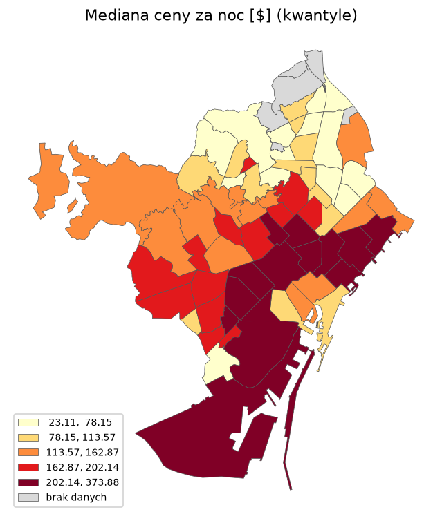
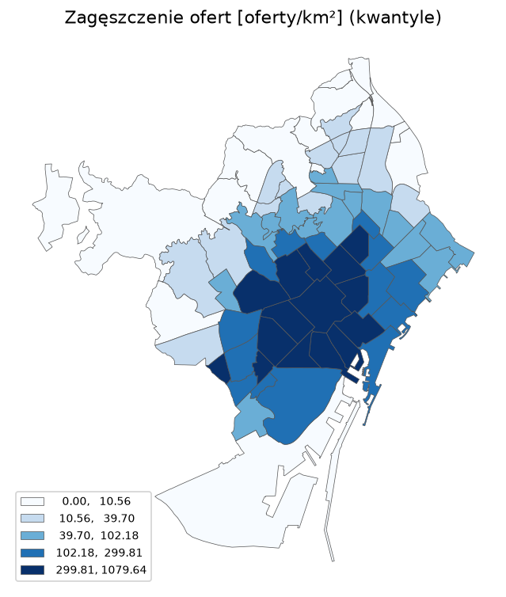
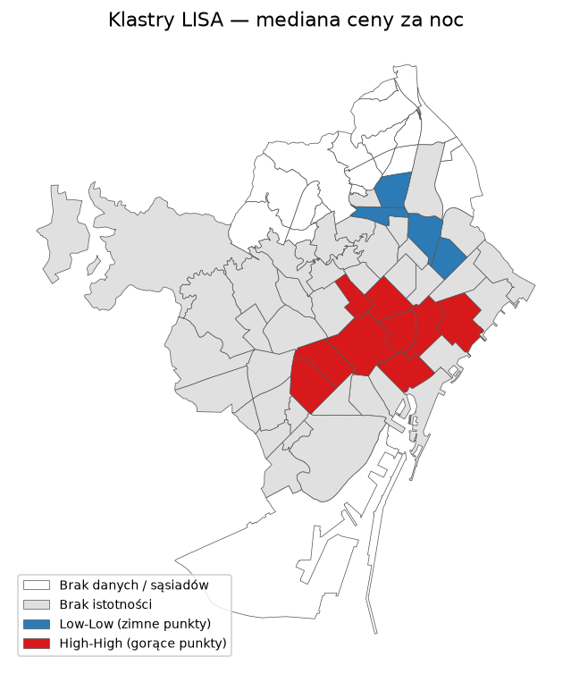

# Wyniki analizy — Barcelona

> Plik wygenerowany automatycznie przez `scripts/generate_results.py` z rzeczywistych obliczeń na danych Inside Airbnb (wydanie **2026-09-17**, pobrano 2026-11-03T12:53:59+00:00). Nie edytuj ręcznie.

Parametry: permutacje = 999, ziarno = 42, próg wiarygodności dzielnicy = 10 ofert z ceną, filtry: brak.

## 1. Dane i jakość

| Krok | Liczba |
|---|---|
| Rekordy w pliku źródłowym | 15236 |
| Usunięte duplikaty (powtórzone id) | 0 |
| Rekordy po deduplikacji | 15236 |
| Brak ceny (pole puste) | 2626 |
| Cena niepoprawna (≤ 0 lub nieliczbowa) | 0 |
| Rekordy z poprawną ceną | 12610 |
| Niepoprawne współrzędne (brak / poza zakresem / 0,0) | 0 |
| Współrzędne poza obszarem miasta | 0 |
| Oznaczone jako odstające (cena, IQR na ln) | 188 |

Płotki Tukeya (k = 1,5, ln ceny): 17.6 – 1506.2 $. Symbol waluty w źródle: $.

Geometrie dzielnic: 75 obiektów w pliku → 73 dzielnic po scaleniu powtórzonych nazw. Zgodność Spatial Join z etykietą źródłową `neighbourhood_cleansed`: **100.00%**; oferty poza granicami: 0.

## 2. Rynek (wszystkie oferty z ceną)

| Miara | Wartość |
|---|---|
| Oferty w źródle | 15 236 |
| Oferty z ceną | 12 610 |
| Średnia cena [$] | 253.41 |
| Mediana ceny [$] | 190.67 |
| Odchylenie std. [$] | 386.34 |
| Min [$] | 12.81 |
| Maks [$] | 11245.03 |
| Dzielnice z ofertami | 68 |
| Dzielnice wiarygodne (≥ próg) | 53 |

Udział typów pokoju:

| Typ pokoju | % |
|---|---|
| Entire home/apt | 69.60 |
| Private room | 29.10 |
| Shared room | 0.80 |
| Hotel room | 0.50 |

## 3. Dzielnice — rankingi (dzielnice wiarygodne)

**10 najdroższych (mediana ceny):**

| Dzielnica | Oferty | Z ceną | Mediana $ | Średnia $ | Odch. std $ | Oferty/km² |
|---|---|---|---|---|---|---|
| la Vila Olímpica del Poblenou | 140 | 123 | 269.0 | 284.8 | 186.4 | 148.5 |
| Diagonal Mar i el Front Marítim del Poblenou | 126 | 106 | 268.9 | 337.7 | 256.7 | 101.9 |
| la Dreta de l'Eixample | 2186 | 1912 | 252.5 | 344.7 | 488.4 | 1 029.4 |
| el Fort Pienc | 430 | 362 | 237.2 | 238.2 | 193.5 | 462.9 |
| la Sagrada Família | 916 | 791 | 233.5 | 308.6 | 527.2 | 871.5 |
| Sant Antoni | 815 | 699 | 224.0 | 316.2 | 435.1 | 1 017.5 |
| la Nova Esquerra de l'Eixample | 621 | 528 | 213.7 | 426.8 | 773.9 | 464.2 |
| l'Antiga Esquerra de l'Eixample | 877 | 744 | 212.1 | 250.3 | 240.0 | 710.4 |
| el Parc i la Llacuna del Poblenou | 166 | 139 | 211.5 | 224.2 | 178.2 | 149.0 |
| el Camp d'en Grassot i Gràcia Nova | 249 | 191 | 206.0 | 213.2 | 128.3 | 383.3 |

**10 najtańszych (mediana ceny):**

| Dzielnica | Oferty | Z ceną | Mediana $ | Średnia $ | Odch. std $ | Oferty/km² |
|---|---|---|---|---|---|---|
| el Turó de la Peira | 17 | 14 | 43.9 | 47.9 | 36.4 | 48.0 |
| la Font d'en Fargues | 23 | 19 | 59.8 | 202.1 | 429.9 | 35.0 |
| Sant Martí de Provençals | 38 | 31 | 60.0 | 100.9 | 84.3 | 51.0 |
| Sant Andreu | 65 | 56 | 68.2 | 126.3 | 201.4 | 35.3 |
| la Marina de Port | 51 | 35 | 74.6 | 105.4 | 84.8 | 40.6 |
| la Sagrera | 40 | 29 | 76.2 | 114.8 | 91.9 | 41.1 |
| la Verneda i la Pau | 25 | 17 | 78.0 | 99.2 | 71.7 | 22.3 |
| el Congrés i els Indians | 35 | 26 | 82.3 | 111.0 | 90.5 | 86.0 |
| el Carmel | 52 | 45 | 85.5 | 126.5 | 93.4 | 55.2 |
| la Barceloneta | 392 | 288 | 86.4 | 141.4 | 139.0 | 298.3 |

**10 dzielnic o największym zagęszczeniu ofert:**

| Dzielnica | Oferty | Z ceną | Mediana $ | Średnia $ | Odch. std $ | Oferty/km² |
|---|---|---|---|---|---|---|
| el Barri Gòtic | 909 | 738 | 136.6 | 241.9 | 517.5 | 1 079.6 |
| la Dreta de l'Eixample | 2186 | 1912 | 252.5 | 344.7 | 488.4 | 1 029.4 |
| Sant Antoni | 815 | 699 | 224.0 | 316.2 | 435.1 | 1 017.5 |
| el Raval | 1072 | 837 | 106.0 | 157.7 | 166.5 | 976.0 |
| la Sagrada Família | 916 | 791 | 233.5 | 308.6 | 527.2 | 871.5 |
| Sant Pere, Santa Caterina i la Ribera | 881 | 721 | 159.0 | 266.0 | 409.6 | 790.7 |
| l'Antiga Esquerra de l'Eixample | 877 | 744 | 212.1 | 250.3 | 240.0 | 710.4 |
| la Vila de Gràcia | 920 | 798 | 199.6 | 224.6 | 300.6 | 693.8 |
| la Nova Esquerra de l'Eixample | 621 | 528 | 213.7 | 426.8 | 773.9 | 464.2 |
| el Fort Pienc | 430 | 362 | 237.2 | 238.2 | 193.5 | 462.9 |

**10 dzielnic o największej liczbie ofert:**

| Dzielnica | Oferty | Z ceną | Mediana $ | Średnia $ | Odch. std $ | Oferty/km² |
|---|---|---|---|---|---|---|
| la Dreta de l'Eixample | 2186 | 1912 | 252.5 | 344.7 | 488.4 | 1 029.4 |
| el Raval | 1072 | 837 | 106.0 | 157.7 | 166.5 | 976.0 |
| la Vila de Gràcia | 920 | 798 | 199.6 | 224.6 | 300.6 | 693.8 |
| la Sagrada Família | 916 | 791 | 233.5 | 308.6 | 527.2 | 871.5 |
| el Barri Gòtic | 909 | 738 | 136.6 | 241.9 | 517.5 | 1 079.6 |
| Sant Pere, Santa Caterina i la Ribera | 881 | 721 | 159.0 | 266.0 | 409.6 | 790.7 |
| l'Antiga Esquerra de l'Eixample | 877 | 744 | 212.1 | 250.3 | 240.0 | 710.4 |
| Sant Antoni | 815 | 699 | 224.0 | 316.2 | 435.1 | 1 017.5 |
| el Poble Sec | 689 | 594 | 206.0 | 273.4 | 365.5 | 149.6 |
| la Nova Esquerra de l'Eixample | 621 | 528 | 213.7 | 426.8 | 773.9 | 464.2 |

## 4. Autokorelacja przestrzenna

Zmienna: **mediana ceny za noc**, wagi: Queen (standaryzacja wierszowa).

| Parametr | Wartość |
|---|---|
| Zmienna | median_price |
| Macierz wag | Queen (wspólny bok lub wierzchołek), standaryzacja wierszowa |
| Liczba jednostek w analizie | 53 |
| Średnia liczba sąsiadów | 4.94 |
| Moran's I | 0.3757 |
| E[I] przy braku autokorelacji | -0.0192 |
| z (symulacja) | 4.611 |
| pseudo-p dwustronne (permutacje = 999) | 0.002 |
| pseudo-p jednostronne (esda) | 0.001 |
| p (aproksymacja normalna) | 0.0 |

**Interpretacja:** Istotna dodatnia autokorelacja przestrzenna (I = 0.376, pseudo-p = 0.002 < 0.05): dzielnice o podobnym poziomie cen sąsiadują ze sobą — ceny tworzą skupiska.

Wyłączone z analizy: 20 dzielnic (za mało ofert z ceną lub brak sąsiadów).

### Klastry LISA (pseudo-p < 0,05)

| Klasa | Liczba dzielnic |
|---|---|
| High-High (gorące punkty) | 9 |
| Low-Low (zimne punkty) | 4 |
| High-Low (wysoka wśród niskich) | 0 |
| Low-High (niska wśród wysokich) | 0 |
| Brak istotności | 40 |
| Brak danych / sąsiadów | 20 |

| Dzielnica | Klaster | Mediana $ | Z ceną | Local I | pseudo-p | Istotny po FDR |
|---|---|---|---|---|---|---|
| el Poblenou | HH | 202.430 | 359 | 0.999 | 0.007 | False |
| el Fort Pienc | HH | 237.165 | 362 | 1.474 | 0.013 | False |
| la Nova Esquerra de l'Eixample | HH | 213.675 | 528 | 0.858 | 0.023 | False |
| la Sagrada Família | HH | 233.500 | 791 | 0.952 | 0.025 | False |
| el Camp d'en Grassot i Gràcia Nova | HH | 206.000 | 191 | 0.714 | 0.031 | False |
| la Dreta de l'Eixample | HH | 252.500 | 1912 | 0.875 | 0.035 | False |
| Sant Pere, Santa Caterina i la Ribera | HH | 158.970 | 721 | 0.065 | 0.035 | False |
| el Parc i la Llacuna del Poblenou | HH | 211.500 | 139 | 0.635 | 0.041 | False |
| l'Antiga Esquerra de l'Eixample | HH | 212.120 | 744 | 0.816 | 0.047 | False |
| Vilapicina i la Torre Llobeta | LL | 111.510 | 16 | 0.857 | 0.003 | False |
| la Sagrera | LL | 76.230 | 29 | 1.567 | 0.003 | False |
| Porta | LL | 103.030 | 12 | 1.196 | 0.005 | False |
| Sant Martí de Provençals | LL | 60.000 | 31 | 1.542 | 0.039 | False |

### Odporność wyniku: inne macierze wag i zmienne

| Zmienna | Wagi | n | Moran's I | pseudo-p |
|---|---|---|---|---|
| Mediana ceny za noc | queen | 53 | 0.376 | 0.002 |
| Mediana ceny za noc | rook | 53 | 0.376 | 0.002 |
| Mediana ceny za noc | knn | 53 | 0.394 | 0.002 |
| Średnia cena za noc | queen | 53 | 0.383 | 0.002 |
| Średnia cena za noc | rook | 53 | 0.383 | 0.002 |
| Średnia cena za noc | knn | 53 | 0.338 | 0.002 |
| Mediana ceny za osobę | queen | 53 | 0.132 | 0.098 |
| Mediana ceny za osobę | rook | 53 | 0.132 | 0.098 |
| Mediana ceny za osobę | knn | 53 | 0.163 | 0.022 |
| Zagęszczenie ofert | queen | 53 | 0.604 | 0.002 |
| Zagęszczenie ofert | rook | 53 | 0.604 | 0.002 |
| Zagęszczenie ofert | knn | 53 | 0.563 | 0.002 |
| Udział całych mieszkań | queen | 53 | 0.210 | 0.014 |
| Udział całych mieszkań | rook | 53 | 0.210 | 0.014 |
| Udział całych mieszkań | knn | 53 | 0.246 | 0.008 |
| Średnia ocena | queen | 53 | -0.014 | 0.898 |
| Średnia ocena | rook | 53 | -0.014 | 0.898 |
| Średnia ocena | knn | 53 | -0.016 | 0.924 |
| Szac. obłożenie roczne | queen | 53 | 0.163 | 0.058 |
| Szac. obłożenie roczne | rook | 53 | 0.163 | 0.058 |
| Szac. obłożenie roczne | knn | 53 | 0.194 | 0.018 |

### Wpływ ofert odstających

| Wariant | Liczba ofert | Średnia cena | Mediana ceny | Odch. std. ceny | Maks. cena | Moran's I | pseudo-p |
|---|---|---|---|---|---|---|---|
| z odstającymi | 15236 | 253.414 | 190.670 | 386.336 | 11 245.030 | 0.376 | 0.002 |
| bez odstających | 15048 | 216.130 | 189.000 | 175.329 | 1 502.000 | 0.370 | 0.002 |

## 5. Wpływ lokalizacji na cenę

| Model OLS dla ln(ceny) | Skorygowane R² |
|---|---|
| Cechy oferty (goście + typ pokoju) | 0.509 |
| Sama dzielnica | 0.097 |
| Cechy oferty + odległość od centrum | 0.524 |
| Cechy oferty + dzielnica | 0.543 |

Spearman (cena vs odległość od centrum): ρ = -0.134, n = 12610.

## 6. Rysunki

